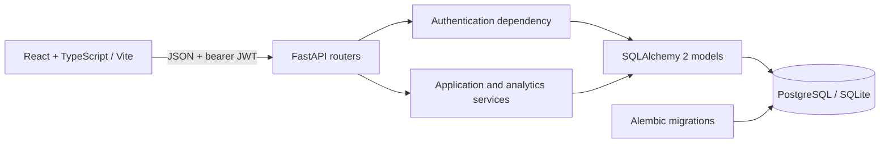
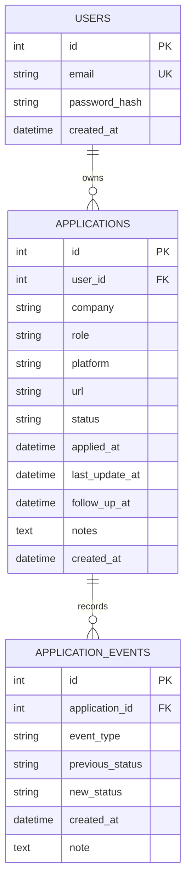

<<<<<<< HEAD
# Applyboard — Job Tracker

Applyboard is a full-stack job-application tracker built as a portfolio project. It helps a job seeker organize applications, record status history, schedule follow-ups, and understand response outcomes without treating each status change as a new application.

## Features

- Argon2 password hashing, bearer JWT access tokens, and private user-scoped routes.
- Application create, read, update, and delete with search, platform/status filters, pagination, and sorting.
- Explicit status-transition rules and a chronological event history.
- Dashboard analytics for unique applications, response rates, response time, follow-ups, and possible ghosting.
- Responsive React/TypeScript interface with status/platform charts, application search, and history.
- Alembic-managed PostgreSQL schema; SQLite is the zero-setup local default.
- Isolated backend tests with coverage enforcement, Docker Compose, and GitHub Actions.

## Architecture



Backend code separates configuration/security, SQLAlchemy models, Pydantic schemas, route handlers, and reusable services. The frontend keeps API calls and server state separate from pages and shared form/table components.

## Data model



Email is unique. Application ownership is enforced by filtering queries through the authenticated user. Foreign keys cascade deletes from user to applications and application to events. Statuses are constrained to `applied`, `replied`, `interview`, `offer`, `rejected`, and `ghosted`.

## Analytics definitions and business rules

- **Total applications** counts each application record once; status changes never create extra applications.
- A **recorded response** is a status-change event into `replied`, `interview`, `offer`, or `rejected`. A record starting at one of those statuses is not assumed to have a known response date.
- **Response rate** is distinct applications with at least one recorded response divided by all applications; it is represented as a ratio from `0` to `1` (multiply by 100 for percent).
- **Average time to first response** is the mean elapsed time from `applied_at` to the earliest response event. Negative durations are excluded. It is `null` when no valid response times exist.
- Platform metrics use the same unique-application and response-event definitions.
- **Upcoming follow-ups** include scheduled follow-ups from now through 30 days ahead, excluding terminal statuses.
- **May be ghosted** is advisory only: an application still in `applied`, with no recorded response, and an application date at least 14 days old. It is never automatically changed to `ghosted`.
- Status transitions are one-way: `applied` → `replied`, `interview`, `offer`, `rejected`, or `ghosted`; `replied` → `interview`, `offer`, `rejected`, or `ghosted`; `interview` → `offer`, `rejected`, or `ghosted`. `offer`, `rejected`, and `ghosted` are terminal. Repeating the current status is allowed.

## API

OpenAPI/Swagger is available at `http://localhost:8000/docs` while the API is running.

| Method | Path | Access | Purpose |
|---|---|---|---|
| `GET` | `/health` | Public | Liveness check |
| `POST` | `/auth/register` | Public | Create account |
| `POST` | `/auth/login` | Public | Return bearer access token |
| `GET` | `/auth/me` | Bearer token | Read current user |
| `GET` | `/applications` | Bearer token | Search/filter/sort/paginate owned applications |
| `POST` | `/applications` | Bearer token | Create application |
| `GET` | `/applications/{application_id}` | Bearer token | Read owned application |
| `PATCH` | `/applications/{application_id}` | Bearer token | Update owned application |
| `DELETE` | `/applications/{application_id}` | Bearer token | Delete owned application |
| `GET` | `/applications/{application_id}/events` | Bearer token | Read owned application history |
| `GET` | `/stats/summary` | Bearer token | Dashboard metrics and follow-up candidates |
| `GET` | `/stats/platforms` | Bearer token | Per-platform response metrics |
| `GET` | `/stats/responses` | Bearer token | Overall response metrics |

List query parameters are `page` (default `1`), `page_size` (default `20`, maximum `100`), `search`, `status`, `platform`, `sort_by` (`applied_at`, `company`, or `last_update_at`), and `order` (`asc` or `desc`). Invalid request input returns `422`; invalid credentials return `401`; another user’s application is indistinguishable from a missing application (`404`); duplicate email is `409`; invalid status transitions are `409`.

### Example requests

Register and log in:

```powershell
$body = @{ email = "person@example.com"; password = "safe-password-123" } | ConvertTo-Json
Invoke-RestMethod -Method Post -Uri http://localhost:8000/auth/register -ContentType "application/json" -Body $body
$login = Invoke-RestMethod -Method Post -Uri http://localhost:8000/auth/login -ContentType "application/json" -Body $body
$headers = @{ Authorization = "Bearer $($login.access_token)" }
```

Create, list, and inspect analytics:

```powershell
$application = @{
  company = "Example Co"
  role = "Software Engineer"
  platform = "Company website"
  url = "https://example.com/jobs/42"
  follow_up_at = (Get-Date).AddDays(7).ToUniversalTime().ToString("o")
  notes = "Contact recruiter next week"
} | ConvertTo-Json
Invoke-RestMethod -Method Post -Uri http://localhost:8000/applications -Headers $headers -ContentType "application/json" -Body $application
Invoke-RestMethod -Uri "http://localhost:8000/applications?search=Engineer&page=1&page_size=20" -Headers $headers
Invoke-RestMethod -Uri http://localhost:8000/stats/summary -Headers $headers
```

## Local development (Windows PowerShell)

### Backend

Install Python 3.12+, then from the repository root:

```powershell
Set-Location .\backend
py -3.12 -m venv .venv
.\.venv\Scripts\python.exe -m pip install --upgrade pip
.\.venv\Scripts\python.exe -m pip install -r requirements-dev.txt
$env:JWT_SECRET = & .\.venv\Scripts\python.exe -c "import secrets; print(secrets.token_urlsafe(48))"
.\.venv\Scripts\python.exe -m alembic upgrade head
.\.venv\Scripts\python.exe -m uvicorn app.main:app --reload
```

The default database is `sqlite:///./job_tracker.db` relative to `backend`. For PostgreSQL, set `DATABASE_URL` to a URL using the `postgresql+psycopg://` driver. CORS is temporarily open to all origins for connection testing; restrict it to trusted frontend origins before production use.

### Frontend

In another PowerShell window:

```powershell
Set-Location .\frontend
npm ci
npm run dev
```

Vite serves the frontend at `http://localhost:5173`. Set `VITE_API_BASE_URL` before starting Vite or at build time to configure the API origin.

## Environment variables

| Variable | Required | Description |
|---|---:|---|
| `DATABASE_URL` | No for SQLite | SQLAlchemy database URL; defaults to local SQLite |
| `JWT_SECRET` | Yes for login/token use | Random secret of at least 32 bytes |
| `VITE_API_BASE_URL` | Yes | API origin embedded into the frontend build |
| `POSTGRES_USER` | Docker Compose | Local PostgreSQL username |
| `POSTGRES_PASSWORD` | Docker Compose | Local PostgreSQL password; use URL-safe characters |
| `POSTGRES_DB` | Docker Compose | Local PostgreSQL database name |

Never commit real credentials or production URLs. Use a unique random JWT secret for each environment. Root `.env.example` contains placeholders for Compose; copy it to `.env`, replace the secret values, and keep `.env` private. For local backend-only development, set `JWT_SECRET` in the PowerShell session before starting Uvicorn.

## Migrations

Models describe the current schema; Alembic revisions are the source of schema changes. Apply migrations with:

```powershell
Set-Location .\backend
.\.venv\Scripts\python.exe -m alembic upgrade head
```

Check for model/migration drift with `.\.venv\Scripts\python.exe -m alembic check`. For a deliberate schema change, update the SQLAlchemy model, generate or author a reviewed revision with `alembic revision --autogenerate -m "describe change"`, inspect the revision, then apply it. Do not use `Base.metadata.create_all()` as a production migration mechanism.

## Tests and coverage

The backend test fixture creates a temporary SQLite database per test and overrides the application database dependency. Tests never connect to the configured development or production database.

```powershell
Set-Location .\backend
.\.venv\Scripts\python.exe -m pytest -q
```

Coverage is measured by `pytest-cov` and enforced at 80% by `pytest.ini`. Verified during implementation: **25 backend tests passed with 97.85% statement coverage**. The suite covers authentication, CRUD, validation, ownership, pagination, metrics, follow-up/ghosting rules, event history, CORS, and database constraints.

Frontend checks:

```powershell
Set-Location .\frontend
npm ci
npm run lint
npm run build
```

## Docker Compose

Copy `.env.example` to `.env`, replace `POSTGRES_PASSWORD` and `JWT_SECRET`, then from the repository root:

```powershell
Copy-Item .env.example .env
# Edit .env and replace both secret placeholders before starting.
docker compose up --build
```

The Compose stack starts PostgreSQL with a named persistent volume, waits for the database health check, applies Alembic migrations in the API container, and serves the UI at `http://localhost:3000` and API at `http://localhost:8000`. To stop containers without removing data, use `docker compose down`. Removing the named volume destroys local database data; do so only when that is intended.

## Deployment (Render example)

1. Create a managed PostgreSQL instance in Render and keep its internal connection URL private.
2. Create a backend web service from the repository using `backend` as the root directory and its Dockerfile. Set `DATABASE_URL` to the provider URL using the `postgresql+psycopg://` SQLAlchemy driver and generate a unique `JWT_SECRET` with at least 32 random bytes. The backend image applies migrations before starting Uvicorn.
3. Create a Render Static Site using `frontend` as the root directory; build command `npm ci && npm run build`; publish directory `dist`. Set `VITE_API_BASE_URL` to the deployed backend origin and add a rewrite from `/*` to `/index.html` for React Router routes.
4. After connection testing, restrict backend CORS to the exact deployed frontend origin and redeploy.
5. Use HTTPS for both services, enable provider backups for PostgreSQL, and use the platform secret manager for all credentials. Never use local Compose credentials in production.

The UI currently stores the short-lived bearer token in browser `sessionStorage`; this is cleared when the tab session ends or a `401` response indicates expiration. For stricter production threat models, move token handling to secure, `HttpOnly`, `SameSite` cookies and add CSRF protections before deployment.

## Screenshots

Add current desktop and mobile screenshots here after running the application. Capture the dashboard, applications list, and application history view; avoid screenshots containing personal account data.
=======
# Applyboard — Job Tracker

Applyboard is a full-stack job-application tracker built as a portfolio project. It helps a job seeker organize applications, record status history, schedule follow-ups, and understand response outcomes without treating each status change as a new application.

## Features

- Argon2 password hashing, bearer JWT access tokens, and private user-scoped routes.
- Application create, read, update, and delete with search, platform/status filters, pagination, and sorting.
- Explicit status-transition rules and a chronological event history.
- Dashboard analytics for unique applications, response rates, response time, follow-ups, and possible ghosting.
- Responsive React/TypeScript interface with status/platform charts, application search, and history.
- Alembic-managed PostgreSQL schema; SQLite is the zero-setup local default.
- Isolated backend tests with coverage enforcement, Docker Compose, and GitHub Actions.

## Architecture


Backend code separates configuration/security, SQLAlchemy models, Pydantic schemas, route handlers, and reusable services. The frontend keeps API calls and server state separate from pages and shared form/table components.

## Data model


Email is unique. Application ownership is enforced by filtering queries through the authenticated user. Foreign keys cascade deletes from user to applications and application to events. Statuses are constrained to `applied`, `replied`, `interview`, `offer`, `rejected`, and `ghosted`.

## Analytics definitions and business rules

- **Total applications** counts each application record once; status changes never create extra applications.
- A **recorded response** is a status-change event into `replied`, `interview`, `offer`, or `rejected`. A record starting at one of those statuses is not assumed to have a known response date.
- **Response rate** is distinct applications with at least one recorded response divided by all applications; it is represented as a ratio from `0` to `1` (multiply by 100 for percent).
- **Average time to first response** is the mean elapsed time from `applied_at` to the earliest response event. Negative durations are excluded. It is `null` when no valid response times exist.
- Platform metrics use the same unique-application and response-event definitions.
- **Upcoming follow-ups** include scheduled follow-ups from now through 30 days ahead, excluding terminal statuses.
- **May be ghosted** is advisory only: an application still in `applied`, with no recorded response, and an application date at least 14 days old. It is never automatically changed to `ghosted`.
- Status transitions are one-way: `applied` → `replied`, `interview`, `offer`, `rejected`, or `ghosted`; `replied` → `interview`, `offer`, `rejected`, or `ghosted`; `interview` → `offer`, `rejected`, or `ghosted`. `offer`, `rejected`, and `ghosted` are terminal. Repeating the current status is allowed.

## API

OpenAPI/Swagger is available at `http://localhost:8000/docs` while the API is running.

| Method | Path | Access | Purpose |
|---|---|---|---|
| `GET` | `/health` | Public | Liveness check |
| `POST` | `/auth/register` | Public | Create account |
| `POST` | `/auth/login` | Public | Return bearer access token |
| `GET` | `/auth/me` | Bearer token | Read current user |
| `GET` | `/applications` | Bearer token | Search/filter/sort/paginate owned applications |
| `POST` | `/applications` | Bearer token | Create application |
| `GET` | `/applications/{application_id}` | Bearer token | Read owned application |
| `PATCH` | `/applications/{application_id}` | Bearer token | Update owned application |
| `DELETE` | `/applications/{application_id}` | Bearer token | Delete owned application |
| `GET` | `/applications/{application_id}/events` | Bearer token | Read owned application history |
| `GET` | `/stats/summary` | Bearer token | Dashboard metrics and follow-up candidates |
| `GET` | `/stats/platforms` | Bearer token | Per-platform response metrics |
| `GET` | `/stats/responses` | Bearer token | Overall response metrics |

List query parameters are `page` (default `1`), `page_size` (default `20`, maximum `100`), `search`, `status`, `platform`, `sort_by` (`applied_at`, `company`, or `last_update_at`), and `order` (`asc` or `desc`). Invalid request input returns `422`; invalid credentials return `401`; another user’s application is indistinguishable from a missing application (`404`); duplicate email is `409`; invalid status transitions are `409`.

### Example requests

Register and log in:

```powershell
$body = @{ email = "person@example.com"; password = "safe-password-123" } | ConvertTo-Json
Invoke-RestMethod -Method Post -Uri http://localhost:8000/auth/register -ContentType "application/json" -Body $body
$login = Invoke-RestMethod -Method Post -Uri http://localhost:8000/auth/login -ContentType "application/json" -Body $body
$headers = @{ Authorization = "Bearer $($login.access_token)" }
```

Create, list, and inspect analytics:

```powershell
$application = @{
  company = "Example Co"
  role = "Software Engineer"
  platform = "Company website"
  url = "https://example.com/jobs/42"
  follow_up_at = (Get-Date).AddDays(7).ToUniversalTime().ToString("o")
  notes = "Contact recruiter next week"
} | ConvertTo-Json
Invoke-RestMethod -Method Post -Uri http://localhost:8000/applications -Headers $headers -ContentType "application/json" -Body $application
Invoke-RestMethod -Uri "http://localhost:8000/applications?search=Engineer&page=1&page_size=20" -Headers $headers
Invoke-RestMethod -Uri http://localhost:8000/stats/summary -Headers $headers
```

## Local development (Windows PowerShell)

### Backend

Install Python 3.12+, then from the repository root:

```powershell
Set-Location .\backend
py -3.12 -m venv .venv
.\.venv\Scripts\python.exe -m pip install --upgrade pip
.\.venv\Scripts\python.exe -m pip install -r requirements-dev.txt
$env:JWT_SECRET = & .\.venv\Scripts\python.exe -c "import secrets; print(secrets.token_urlsafe(48))"
.\.venv\Scripts\python.exe -m alembic upgrade head
.\.venv\Scripts\python.exe -m uvicorn app.main:app --reload
```

The default database is `sqlite:///./job_tracker.db` relative to `backend`. For PostgreSQL, set `DATABASE_URL` to a URL using the `postgresql+psycopg://` driver. CORS is temporarily open to all origins for connection testing; restrict it to trusted frontend origins before production use.

### Frontend

In another PowerShell window:

```powershell
Set-Location .\frontend
npm ci
npm run dev
```

Vite serves the frontend at `http://localhost:5173`. Set `VITE_API_BASE_URL` before starting Vite or at build time to configure the API origin.

## Environment variables

| Variable | Required | Description |
|---|---:|---|
| `DATABASE_URL` | No for SQLite | SQLAlchemy database URL; defaults to local SQLite |
| `JWT_SECRET` | Yes for login/token use | Random secret of at least 32 bytes |
| `VITE_API_BASE_URL` | Yes | API origin embedded into the frontend build |
| `POSTGRES_USER` | Docker Compose | Local PostgreSQL username |
| `POSTGRES_PASSWORD` | Docker Compose | Local PostgreSQL password; use URL-safe characters |
| `POSTGRES_DB` | Docker Compose | Local PostgreSQL database name |

Never commit real credentials or production URLs. Use a unique random JWT secret for each environment. Root `.env.example` contains placeholders for Compose; copy it to `.env`, replace the secret values, and keep `.env` private. For local backend-only development, set `JWT_SECRET` in the PowerShell session before starting Uvicorn.

## Migrations

Models describe the current schema; Alembic revisions are the source of schema changes. Apply migrations with:

```powershell
Set-Location .\backend
.\.venv\Scripts\python.exe -m alembic upgrade head
```

Check for model/migration drift with `.\.venv\Scripts\python.exe -m alembic check`. For a deliberate schema change, update the SQLAlchemy model, generate or author a reviewed revision with `alembic revision --autogenerate -m "describe change"`, inspect the revision, then apply it. Do not use `Base.metadata.create_all()` as a production migration mechanism.

## Tests and coverage

The backend test fixture creates a temporary SQLite database per test and overrides the application database dependency. Tests never connect to the configured development or production database.

```powershell
Set-Location .\backend
.\.venv\Scripts\python.exe -m pytest -q
```

Coverage is measured by `pytest-cov` and enforced at 80% by `pytest.ini`. Verified during implementation: **25 backend tests passed with 97.85% statement coverage**. The suite covers authentication, CRUD, validation, ownership, pagination, metrics, follow-up/ghosting rules, event history, CORS, and database constraints.

Frontend checks:

```powershell
Set-Location .\frontend
npm ci
npm run lint
npm run build
```

## Docker Compose

Copy `.env.example` to `.env`, replace `POSTGRES_PASSWORD` and `JWT_SECRET`, then from the repository root:

```powershell
Copy-Item .env.example .env
# Edit .env and replace both secret placeholders before starting.
docker compose up --build
```

The Compose stack starts PostgreSQL with a named persistent volume, waits for the database health check, applies Alembic migrations in the API container, and serves the UI at `http://localhost:3000` and API at `http://localhost:8000`. To stop containers without removing data, use `docker compose down`. Removing the named volume destroys local database data; do so only when that is intended.

## Deployment (Render example)

1. Create a managed PostgreSQL instance in Render and keep its internal connection URL private.
2. Create a backend web service from the repository using `backend` as the root directory and its Dockerfile. Set `DATABASE_URL` to the provider URL using the `postgresql+psycopg://` SQLAlchemy driver and generate a unique `JWT_SECRET` with at least 32 random bytes. The backend image applies migrations before starting Uvicorn.
3. Create a Render Static Site using `frontend` as the root directory; build command `npm ci && npm run build`; publish directory `dist`. Set `VITE_API_BASE_URL` to the deployed backend origin and add a rewrite from `/*` to `/index.html` for React Router routes.
4. After connection testing, restrict backend CORS to the exact deployed frontend origin and redeploy.
5. Use HTTPS for both services, enable provider backups for PostgreSQL, and use the platform secret manager for all credentials. Never use local Compose credentials in production.

The UI currently stores the short-lived bearer token in browser `sessionStorage`; this is cleared when the tab session ends or a `401` response indicates expiration. For stricter production threat models, move token handling to secure, `HttpOnly`, `SameSite` cookies and add CSRF protections before deployment.

## Screenshots

Add current desktop and mobile screenshots here after running the application. Capture the dashboard, applications list, and application history view; avoid screenshots containing personal account data.
>>>>>>> 9e21017a5c3f47da97337baab90eeb0df04fc2ca
